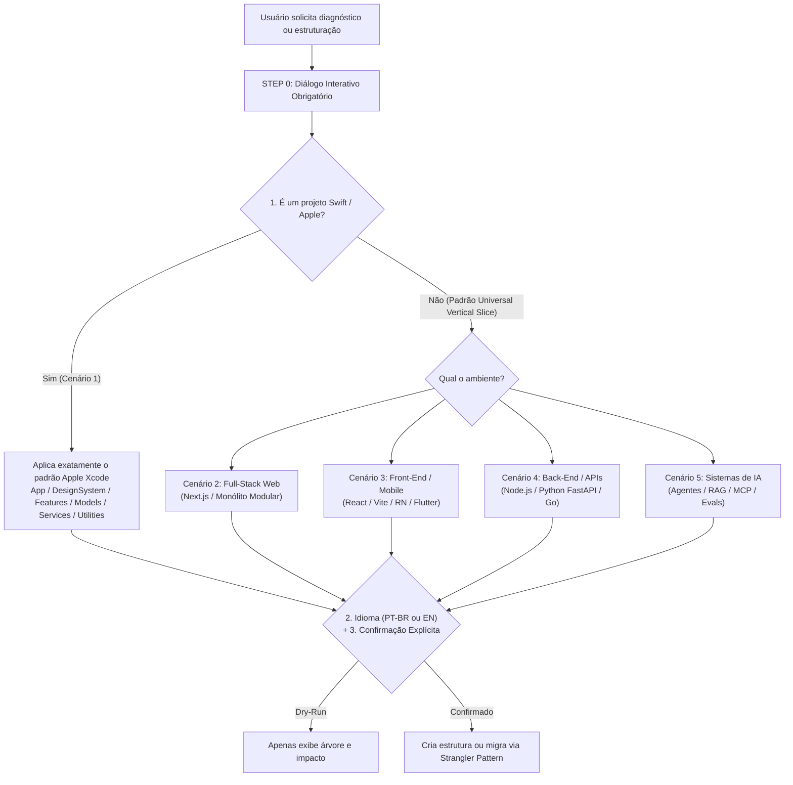

# 🏗️ Feature-First & Vertical Slice Architecture (`feature-first-architecture`)

> **Skill com Diálogo Interativo e Confirmação Obrigatória para 5 Cenários Arquiteturais (Apple Swift/SwiftUI, Full-Stack Web, Front-End/Mobile, Back-End/APIs e Sistemas de IA/Agentes/RAG)**  
> **Autor:** Mizael Souto  
> **Modo de Operação:** 🔒 **Somente com Confirmação Explícita via Diálogo (`STEP 0`)**

---

## 📌 Como Funciona o Fluxo de Decisão (`STEP 0`)

Esta skill **nunca é acionada de forma deliberada ou silenciosa**. Sempre que invocada, o agente inicia com um **Diálogo Interativo de 3 Perguntas** antes de criar ou mover qualquer arquivo:



---

## 🧭 Os 5 Cenários Cobertos pela Skill

| Cenário | Ambiente / Stack | Raiz e Zonas Principais | Anatomia Interna de Cada Fatia (`Feature`) |
| :--- | :--- | :--- | :--- |
| **1. Nativo Apple** | `Swift / SwiftUI` (iOS, macOS) | `App/`, `DesignSystem/`, `Features/`, `Models/`, `Services/`, `Utilities/`, `Preview Content/` | `<Feature>Screen.swift` + subviews locais (`*Bar.swift`, `*View.swift`) |
| **2. Full-Stack Web** | `Next.js / Nuxt / Remix` | `src/app/`, `src/components/ui/`, `src/modulos/`, `src/compartilhado/` | `modelo.ts`, `repo.ts`, `migracoes.ts`, `api.ts`, `cliente.ts`, `publico.ts`, `componentes/` |
| **3. Front-End / Mobile** | `React / Vite / RN / Expo / Flutter` | `src/app/`, `src/design-system/`, `src/features/`, `src/models/`, `src/services/`, `src/utilities/` | `<Feature>Screen.tsx`, subcomponentes locais, `use<Feature>.ts`, `<feature>.api.ts` |
| **4. Back-End / APIs** | `Node.js / Python FastAPI / Go / Rust` | `src/app/`, `src/features/`, `src/models/`, `src/services/`, `src/utilities/` *(sem UI)* | `routes`, `usecase`, `model` (regras puras + schemas), `repo`, `public`, `test` |
| **5. IA / Agentes / RAG** | `Python / TS + LLMs / LangGraph / MCP` | `src/app/`, `src/features/`, `src/models/`, `src/services/{llm,vector-db,guardrails}/`, `src/utilities/` | `model.py`, `prompts.py`, `tools.py`, `agent.py`, `repo.py` (busca híbrida), `evals.py` |

---

## 📂 Exemplos Visuais por Cenário

### 🍎 Cenário 1 — Nativo Apple (`Swift / SwiftUI`)
```text
UnderwaterSurvey/
├── App/
├── DesignSystem/
├── Features/
│   ├── Capture/
│   │   ├── CaptureControlsBar.swift
│   │   ├── CaptureCountdownView.swift
│   │   ├── CaptureQualityIndicator.swift
│   │   ├── CaptureScreen.swift
│   │   └── SonarFeedView.swift
│   ├── DiveLog/
│   ├── Settings/
│   ├── SiteList/
│   └── SurveyViewer/
├── Models/
├── Preview Content/
├── Services/
├── Utilities/
└── Assets.xcassets
```

### 🌐 Cenário 2 — Full-Stack Web (`Next.js / Monólito Modular`)
```text
src/
├── app/                        # Casca fina de rotas (page.tsx e api/route.ts)
├── components/ui/              # Design System isolado
├── modulos/                    # (ou features/)
│   └── ofertas/
│       ├── modelo.ts           # Regras puras (100% testáveis sem banco/rede)
│       ├── repo.ts             # Persistência SQL/ORM do domínio
│       ├── migracoes.ts        # Evolução do banco exclusiva do módulo
│       ├── api.ts              # Caso de uso no servidor
│       ├── cliente.ts          # Hooks e cliente HTTP
│       ├── publico.ts          # Contrato público para outros módulos
│       └── componentes/        # UI exclusiva de ofertas
└── compartilhado/              # Infraestrutura transversal (db, http, armazenamento, tema)
```

### 🤖 Cenário 5 — Sistemas com IA / Agentes Autônomos / RAG
```text
src/
├── app/                        # API/Worker + Telemetria (OpenTelemetry / Langfuse)
├── features/
│   └── triagem-documentos/
│       ├── model.py            # Contratos estruturados e validação pura
│       ├── prompts.py          # System prompts versionados da feature
│       ├── tools.py            # Ferramentas (Function Calling) do agente
│       ├── agent.py            # Orquestração / fluxo do agente
│       ├── repo.py             # Busca híbrida (BM25 + pgvector) do domínio
│       └── evals.py            # Testes de precisão e regressão da feature
├── models/                     # Contratos globais de sessão, mensagens e citações
├── services/
│   ├── llm/                    # Gateway de LLMs, fallbacks e controle de custos
│   ├── vector-db/              # Embeddings e índice vetorial
│   └── guardrails/             # Filtro de PII e proteção contra Prompt Injection
└── utilities/                  # Chunking, contagem de tokens e parsers
```

---

## 📏 As 5 Regras de Ouro

1. **Coesão por Funcionalidade (Colocation):** Tudo o que nasce para atender uma única feature mora dentro da pasta dessa feature.
2. **Regra dos 2 Consumidores:** Só promova um componente para `DesignSystem/` ou um modelo para `Models/` quando **pelo menos 2 features distintas** precisarem dele.
3. **Núcleo de Domínio Puro (`model` / `modelo.ts`):** Regras de validação, cálculos e máquinas de estado devem ser funções puras (sem banco, sem `fetch`, sem UI).
4. **Fronteira Explícita (`publico.ts` / `public.py`):** Uma feature nunca importa arquivos internos (`repo` ou subviews privadas) de outra feature.
5. **Subpastas Sob Demanda:** Enquanto uma feature tiver até ~8 arquivos, mantenha-os na raiz da própria feature. Só crie subpastas internas quando passar de 8–10 arquivos.

---

## 🚀 Instalação e Documentação

- [`SKILL.md`](./SKILL.md) — Instruções operacionais da skill e protocolo do diálogo interativo (`STEP 0`).
- [`docs/GUIA_DETALHADO.md`](./docs/GUIA_DETALHADO.md) — Contratos detalhados dos 5 cenários, equivalência PT-BR ↔ EN e checklist de refatoração incremental (*Strangler Pattern*).
